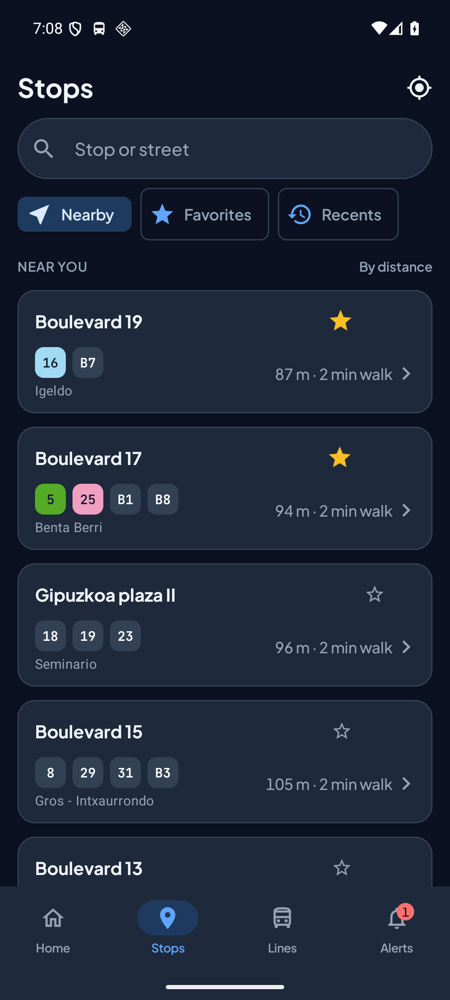
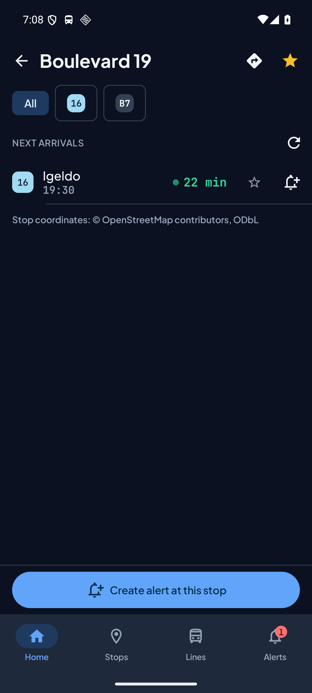
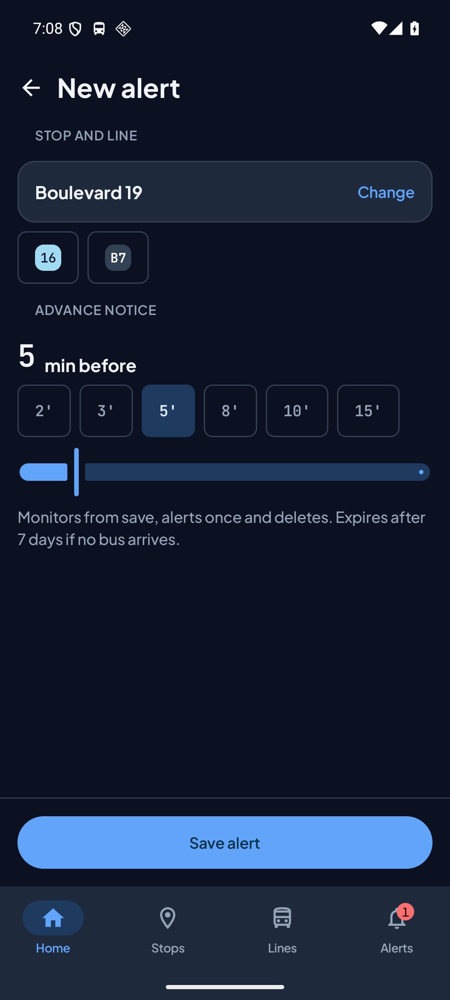
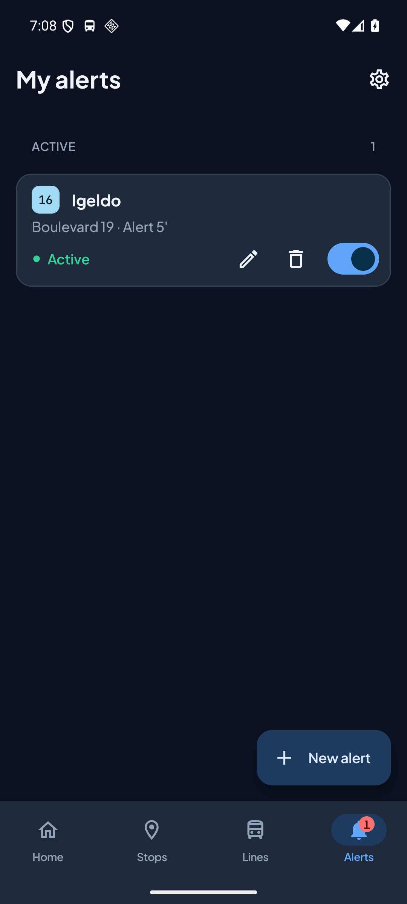
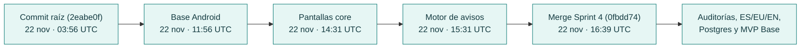
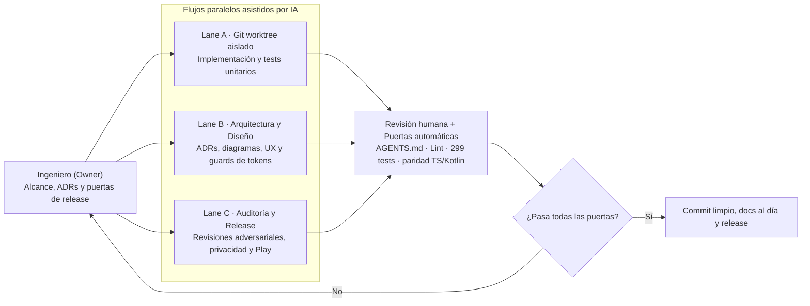
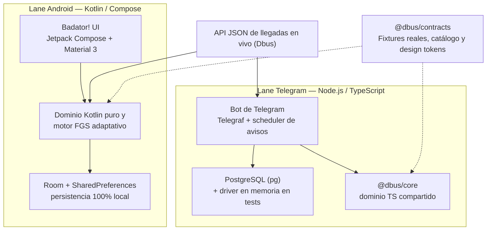

<div align="center">

# Bus Donostia — Badator! (Android) + Bot de Telegram

### Sabe cuándo viene tu autobús. Recibe un aviso en vez de volver a mirar.

<p align="center">
  <a href="README.md"></a>
  <a href="README.es.md"></a>
</p>

**Llegadas GPS en vivo · Descubrimiento offline de paradas · Avisos puntuales adaptativos**  
App nativa de Android (**Badator!**, Kotlin + Jetpack Compose) y **bot de Telegram** en producción (`@dbus/bot`) para Donostia / San Sebastián.

[](https://github.com/IkerGoni/bus-dbus/releases/latest)
[](https://github.com/IkerGoni/bus-dbus/actions/workflows/ci.yml)
[](https://github.com/IkerGoni/bus-dbus/actions/workflows/android.yml)


<p align="center">
  <a href="https://github.com/IkerGoni/bus-dbus/releases/latest"><strong>Descargar APK (MVP Base v1.1.0)</strong></a> ·
  <a href="#por-qué-importa-este-proyecto-a-equipos-de-ingeniería">Resumen técnico</a> ·
  <a href="#arquitectura-de-un-vistazo">Arquitectura</a> ·
  <a href="#decisiones-técnicas-y-trade-offs">Decisiones y ADRs</a> ·
  <a href="#feedback-y-roadmap">Feedback y Roadmap</a>
</p>

<sub>Proyecto open-source independiente desarrollado por <strong>Iker Goñi Cuesta (Dev Igoni)</strong>. Sin afiliación con Dbus.</sub>

</div>

---

## Por qué importa este proyecto a equipos de ingeniería

**Bus Donostia** nació de una fricción cotidiana —abrir y refrescar una app de transporte una y otra vez solo para saber *cuándo salir de casa*— y se convirtió en un caso práctico de **entrega de producto real multicliente con disciplina de producción y velocidad asistida por IA**.

| Señal | Evidencia verificable en este repositorio |
|---|---|
| **Producto desplegable, no prototipo** | APK release firmado de `2,39 MB` (**[MVP Base `v1.1.0`](https://github.com/IkerGoni/bus-dbus/releases/latest)**, `minSdk 26`, `targetSdk 36`, R8 + Baseline Profiles) y bot de Telegram operativo contra datos reales de transporte municipal (cero mocks). |
| **Velocidad con rigor de ingeniería** | Desde el commit raíz (`2eabe0f`) hasta el merge del motor de avisos Android del Sprint 4 (`0fbdd74`) en **12 h 42 min** de tiempo real verificable en Git mediante worktrees paralelos — seguido de auditorías adversariales, paridad ES/EU/EN, migración a PostgreSQL y endurecimiento de release. |
| **Puertas de calidad automatizadas** | **299 tests automatizados** (`143` TypeScript + `156` Android JVM/Robolectric), paridad TS/Kotlin sobre fixtures reales de la API, Android Lint estricto (`HardcodedText` y `MissingTranslation = error`), `DesignTokens` generados en compilación, CI en GitHub Actions y guard de identidad pública (`tools/repo/check-identity.mjs`). |
| **Arquitectura pragmática** | Pivote deliberado a Android nativo ([ADR 009](docs/03-architecture/adrs/009-android-nativo-mvp.md)) con **cero backend de pago**, cero rastreadores/anuncios, capa `domain/` en Kotlin puro lista para KMP (sin imports de Android ni `java.time.*`) y descubrimiento offline (`548` paradas, `39` líneas, `127` itinerarios). |

---

## Producto en acción y MVP Base (`v1.1.0`)

| Paradas cercanas (OSM offline) | Llegadas en vivo | Configurar aviso puntual | Mis avisos activos |
|:---:|:---:|:---:|:---:|
|  |  |  |  |

### Prueba Badator! (Android)

El hito actual es **MVP Base (`v1.1.0`, `versionCode 2`)**, disponible como APK firmado en GitHub mientras se completa la publicación en Google Play:

- **Descargar APK y checksums SHA-256:** [GitHub Releases — `v1.1.0 — MVP Base`](https://github.com/IkerGoni/bus-dbus/releases/latest) (`minSdk 26` / Android 8.0+)
- **Nota de actualización a Google Play:** el APK de GitHub está firmado con la clave de release del proyecto. Al pasar más adelante a Google Play (Play App Signing), conviene desinstalar antes el APK de GitHub.

### Dos clientes, un mismo contrato de producto

| | Bot de Telegram (`apps/bot`) | App nativa Android — **Badator!** (`apps/android`) |
|---|---|---|
| **Uso principal** | Consultar llegadas y programar avisos directamente desde Telegram | Acceso diario rápido con notificaciones locales mediante Foreground Service adaptativo |
| **Funcionalidades** | Llegadas en vivo, búsqueda, líneas, favoritos, paradas cercanas (OSM), scheduler de avisos | Inicio, búsqueda/cercanas offline, líneas, favoritos, avisos puntuales, localización **ES / EU / EN** |
| **Stack** | Node 22+, TypeScript, Telegraf, PostgreSQL (`pg`) + driver en memoria para tests, Zod, Vitest, Biome | Kotlin, Jetpack Compose, Material 3, Room, OkHttp, `kotlinx.serialization`, R8, Baseline Profiles |
| **Verificación** | 93 tests del bot + 50 compartidos (`packages/`) + Biome + `tsc -b` | 156 tests JVM/Robolectric (debug) / 150 (release) + Android Lint + AAB y APK release firmados |
| **Estado** | Listo para producción (API real Dbus, lock de instancia única por PID, retry 409) | **MVP Base (`v1.1.0`)** — APK firmado en [GitHub Releases](https://github.com/IkerGoni/bus-dbus/releases/latest); despliegue en Google Play en curso |

Ambos clientes consumen tiempos en vivo desde la API JSON de Dbus. El catálogo empaquetado (`548` paradas, `39` líneas, `127` itinerarios) acelera la búsqueda offline y el cálculo de cercanía — **nunca inventa ni extrapola horarios**.

---

## Construido rápido. Mejorado con criterio.

El historial de Git forma parte de la historia de ingeniería. En el árbol publicado, el repositorio pasó del commit raíz (`2eabe0f`) al merge del Sprint 4 de Android (`0fbdd74`) —incluyendo el motor de avisos en segundo plano— en **12 horas y 42 minutos de tiempo real transcurrido** (el arranque inicial del workspace empezó antes, el 21 de noviembre a las 18:32 UTC según notas de sesión; esa prehistoria no está en Git), seguido de auditorías adversariales, paridad ES/EU/EN, gobierno de tokens, migración a PostgreSQL y endurecimiento de publicación.

| Transcurrido desde raíz (`2eabe0f`) | Hito registrado |
|---|---|
| **0h 00m** | Commit raíz del repositorio (`2eabe0f`) · **22 nov 2026, 03:56 UTC** |
| **0h 52m** | Integración con API JSON real de Dbus en el bot (`b724cd1`) · **04:49 UTC** |
| **2h 19m** | Split a monorepo con `@dbus/core` y `@dbus/contracts` (`643540b`) · **06:16 UTC** |
| **7h 59m** | Primera base Android en Jetpack Compose (`20479eb`) · **11:56 UTC** |
| **9h 50m** | Pantallas de paradas, detalle de parada y líneas (`281e6c0`) · **13:46 UTC** |
| **10h 34m** | Inicio, avisos, ajustes y onboarding (`45e8fb0`) · **14:31 UTC** |
| **11h 34m** | Motor de avisos y notificaciones con Foreground Service (`172aee5`) · **15:31 UTC** |
| **12h 42m** | Integración de Sprint 4 en `main` (`0fbdd74`) · **16:39 UTC** |
| **Después** | Auditorías adversariales, sondeo adaptativo, paridad ES/EU/EN, `DesignTokens` compilados, PostgreSQL y pipeline de release |

<sub>Los tiempos transcurridos y horas UTC proceden directamente de las fechas de commit en Git (truncados al minuto).</sub>

> **Qué demuestra esto:** ritmo de entrega verificable con `git log`, sin recortar en tests ni en arquitectura. La velocidad viene de **orquestar varios agentes de IA en paralelo bajo guardrails estrictos definidos por un desarrollador**.



---

## Ingeniería asistida por IA, arquitectura dirigida por un humano

Producir rápido solo suma si la base de código sigue siendo coherente, mantenible y publicable. Este repositorio refleja cómo coordino **múltiples agentes de IA en paralelo** manteniendo **arquitectura, alcance, integración y criterios de calidad bajo control humano**:

- **Lanes paralelos sin colisiones:** mientras un agente implementa una funcionalidad o refactor dentro de un **Git worktree aislado** en su *lane* (`apps/android/**` o `apps/bot/**`), otro flujo avanza en paralelo en ADRs, especificaciones UX, paridad de contratos o auditorías de seguridad y publicación.
- **Guardrails explícitos en el repo:** todo trabajo sigue [`AGENTS.md`](AGENTS.md) (reglas de dominio no negociables, propiedad de lanes, modelo de configuración/tokens en 3 niveles, cero IDs internos opacos en UI) y [`docs/contributing/`](docs/contributing/README.md) (Conventional Commits, aislamiento en worktrees y aprobación humana antes de operaciones Git remotas o destructivas).
- **Verificación automática frente a confianza ciega:** las reglas compartidas se bloquean con fixtures reales de la API en `packages/contracts/` y tests de paridad TypeScript/Kotlin, respaldados por **299 tests automatizados**, Biome, Android Lint, GitHub Actions CI y scripts de verificación de publicación (`tools/play-store/`).



---

## Arquitectura de un vistazo

Un monorepo, dos experiencias nativas, **cero backend propio** para Android.



El bot de TypeScript consume `@dbus/core` y `@dbus/contracts`. Android mantiene una capa de **dominio Kotlin puro preparada para KMP** (`domain/` sin dependencias de Android ni `java.time.*`) verificada contra los mismos fixtures reales de la API.

### Mapa del repositorio

```text
apps/
  android/             Badator! — app nativa Kotlin + Jetpack Compose (Gradle)
  bot/                 @dbus/bot — bot de Telegram (Node 22+, TypeScript, PostgreSQL)
  mobile/              @dbus/mobile — prototipo PWA previo, congelado deliberadamente (ADR 009)
packages/
  core/                @dbus/core — lógica de dominio compartida en TypeScript
  contracts/           @dbus/contracts — fixtures reales de API, esquemas y design tokens
tools/
  play-store/          Scripts de verificación de privacidad, Data Safety, euskera y release
  repo/                Guard de identidad pública y rutas locales (activo en CI)
docs/
  03-architecture/     ADRs (incluido ADR 009: pivote a Android nativo)
  08-engineering-plan/ Plan técnico post-MVP (tokens, rendimiento, KMP/iOS)
  auditoria/           Auditorías adversariales y trazabilidad de publicación
  contributing/        Convenciones de commits, worktrees y seguridad Git
  privacy/             Políticas de privacidad publicadas en ES / EU / EN (GitHub Pages)
.github/
  ISSUE_TEMPLATE/      Formularios estructurados de bugs y feedback (ES / EU / EN)
  workflows/           ci.yml (Node), android.yml (Gradle), integration.yml
AGENTS.md              Guardrails de ingeniería y propiedad de lanes
```

---

## Decisiones técnicas y trade-offs

- **Android nativo frente a PWA ([ADR 009](docs/03-architecture/adrs/009-android-nativo-mvp.md)):** se construyó primero un prototipo web y se congeló conscientemente para evitar el sesgo de coste hundido; pasar a Kotlin + Compose permitió ciclo de vida fiable para avisos en segundo plano, persistencia offline y UX nativa sin operar un backend de pago ni Firebase.
- **Comportamiento real de la API frente a specs ideales:** los feeds públicos GTFS-RT `.pb` devolvían `403 AccessDenied`, por lo que ambos clientes se integran de forma defensiva con el endpoint JSON vivo de Dbus — gestionando frescura de datos, origen (`tipo=1` GPS frente a horario) e identidad pública frente a IDs internos de línea (p. ej. línea pública `28` vs ID interno `32`).
- **Avisos puntuales adaptativos frente a sondeo agresivo:** eliges parada, línea y antelación → el Foreground Service adapta los intervalos (`30 s` / `60 s` / `120 s` y escalones ampliados desde `config.json`) → prioriza GPS sobre horario → avisa una vez y se limpia automáticamente (caducidad a 7 días).
- **Configuración en 3 niveles y design tokens en compilación:** los parámetros operativos viven en `assets/config.json` (preparado para override HTTPS opcional), mientras espaciados y animaciones se compilan desde `packages/contracts/design-tokens.json` a constantes Kotlin (`DesignTokens` / `MotionTokens`, blindados con `DesignTokensGuardTest`) — cero parseo JSON en runtime, `@Preview` intacto y respeto estricto a `ANIMATOR_DURATION_SCALE`.
- **Privacidad y operabilidad desde el diseño:** cero analítica, cero anuncios, cero trackers, `android:allowBackup="false"`, ubicación efímera en memoria solo bajo demanda, y lock por PID + reintento de `409` de Telegram en `@dbus/bot`.

---

## Verificación y puesta en marcha

### Requisitos

- **Node.js 22+** y **pnpm** (bot y paquetes compartidos)
- **JDK 17** y **Android SDK** (app Android; ver [`apps/android/README.md`](apps/android/README.md))
- Un **`BOT_TOKEN` de Telegram propio** por variable de entorno si levantas tu instancia (nunca commitear tokens ni reutilizar credenciales de producción)

### Verificar workspaces TypeScript (lint + typecheck + guard de identidad + 143 tests + build)

```bash
pnpm install --frozen-lockfile
pnpm verify
pnpm run build:ci
```

### Verificar y compilar Android (Android Lint + 156 tests JVM debug / 150 release + APK)

```bash
cd apps/android
./gradlew check assembleDebug
```

### Ejecutar el bot de Telegram en local

```bash
cd apps/bot
export BOT_TOKEN='tu_token_de_desarrollo'
pnpm run build && npm run start
```

> **Nota operativa:** no levantar una segunda instancia con polling sobre el mismo `BOT_TOKEN` (provoca conflictos `409` en Telegram). `git push` no despliega ni reinicia el bot de producción.

---

## Feedback y Roadmap

Estamos en **MVP Base (`v1.1.0`)** recogiendo feedback de uso real en el día a día de Donostia para priorizar las siguientes iteraciones.

### Comparte tu feedback (ES / EU / EN bienvenidos)

- **¿Encontraste un fallo o un comportamiento extraño en llegadas/avisos?** [Abrir reporte de error](https://github.com/IkerGoni/bus-dbus/issues/new?template=bug_report.yml)
- **¿Tienes feedback de uso o una idea de mejora?** [Enviar feedback o sugerencia](https://github.com/IkerGoni/bus-dbus/issues/new?template=feedback.yml)
- **Contacto directo:** `dev.mail.igoni@gmail.com`

### Roadmap

- **Ahora — `v1.1.0` (MVP Base)**
  - Llegadas GPS en vivo, descubrimiento offline (`548` paradas, `39` líneas, `127` itinerarios), paradas cercanas (OSM offline), favoritos, avisos puntuales adaptativos, localización ES / EU / EN y bot de Telegram `@dbus/bot`.
- **Soon (Próximamente)**
  - **Publicación en Google Play Store** (prueba cerrada y despliegue público).
  - **Ajustes guiados por feedback** priorizados a partir del uso real de MVP Base.
  - **Pulido UX e interacciones (`v1.2`)** — deslizar para borrar avisos con *deshacer*, asistente animado de configuración de avisos, mascota ligera en Canvas para estados vacíos/onboarding y revisión nativa de euskera.
- **Later / Explorando**
  - **App nativa para iOS (`v2.0`)** — dominio compartido con Kotlin Multiplatform (KMP) + interfaz nativa en SwiftUI.
  - **Configuración remota estática opcional** (`REMOTE_CONFIG_URL`) para ajustar parámetros operativos de sondeo sin requerir actualización de la app.

---

## Estado, limitaciones y dependencias externas

- **Fuente de datos externa:** ambos clientes dependen del endpoint JSON público no oficial de Dbus (`app.dbus.eus`, HTTP cleartext acotado únicamente a ese host en `network_security_config.xml`). La disponibilidad y el esquema dependen del operador.
- **Notificaciones en Android:** la puntualidad de los avisos está sujeta a las optimizaciones de batería del fabricante, permisos de notificación y conectividad.
- **PWA congelada (`apps/mobile`):** conservada por trazabilidad arquitectónica (ADR 009); excluida de CI y sin mantenimiento.

---

## Privacidad, Google Play y Licencia

- **Autor / Soporte:** **Iker Goñi Cuesta (Dev Igoni)** · `dev.mail.igoni@gmail.com`
- **Políticas de privacidad (Badator!):**
  - [Español](https://ikergoni.github.io/bus-dbus/privacy/privacy-policy-es.html) · [Euskara](https://ikergoni.github.io/bus-dbus/privacy/privacy-policy-eu.html) · [English](https://ikergoni.github.io/bus-dbus/privacy/privacy-policy-en.html)
- **Licencia:** el código original del repositorio se distribuye bajo [Licencia MIT](LICENSE). La tipografía empaquetada en `apps/android/licenses/` mantiene su licencia SIL Open Font License 1.1. Las coordenadas de paradas usan datos de OpenStreetMap (`© OpenStreetMap contributors, ODbL`). Las marcas de Dbus y los datos de transporte en vivo pertenecen a sus respectivos titulares.
- **Más documentación:** [`AGENTS.md`](AGENTS.md) · [`docs/README.md`](docs/README.md) · [`docs/contributing/`](docs/contributing/README.md) · [`README.md` (English)](README.md)
