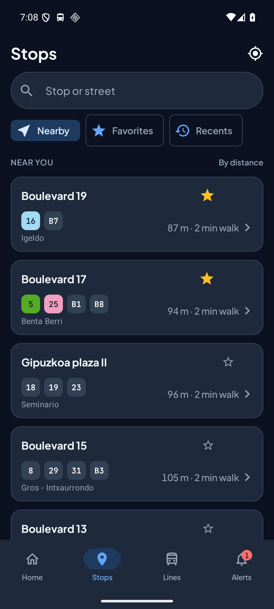
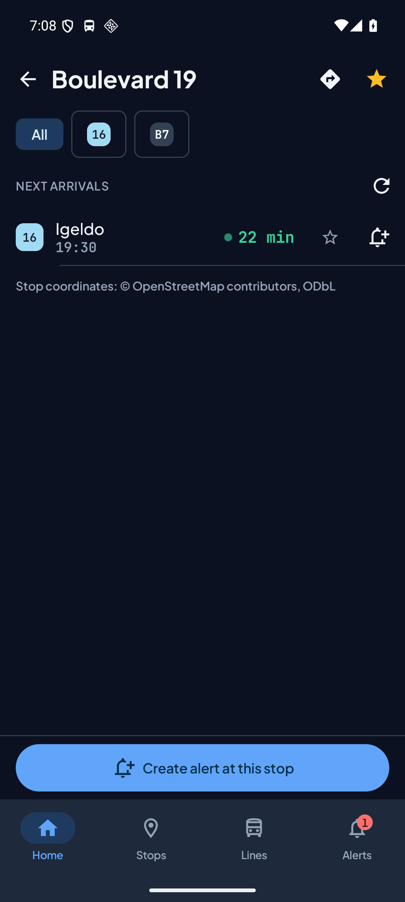
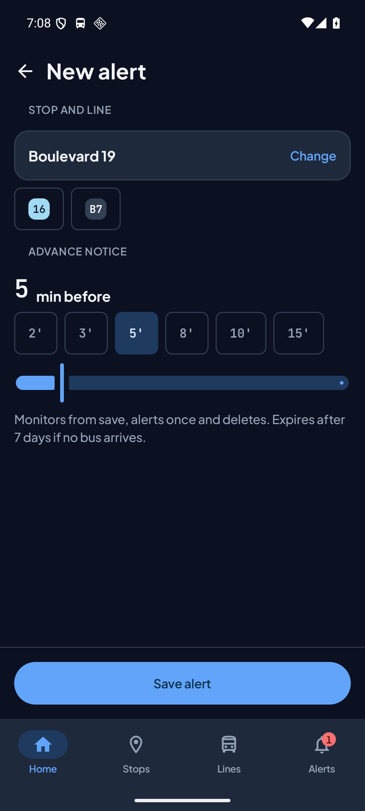
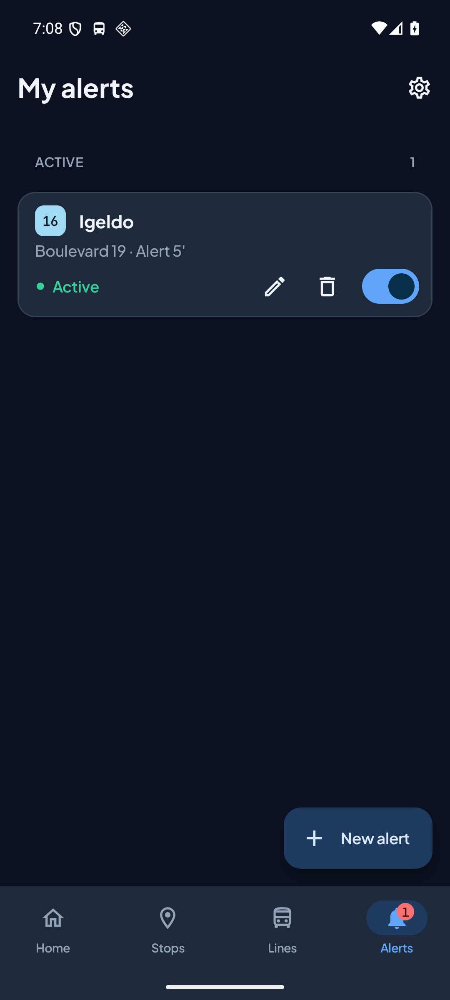
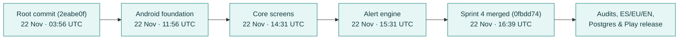
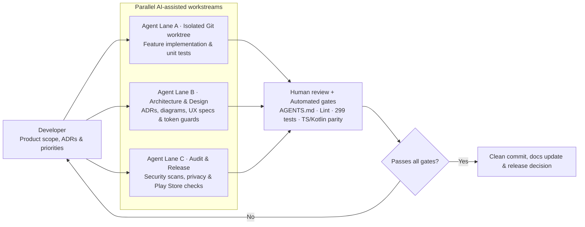
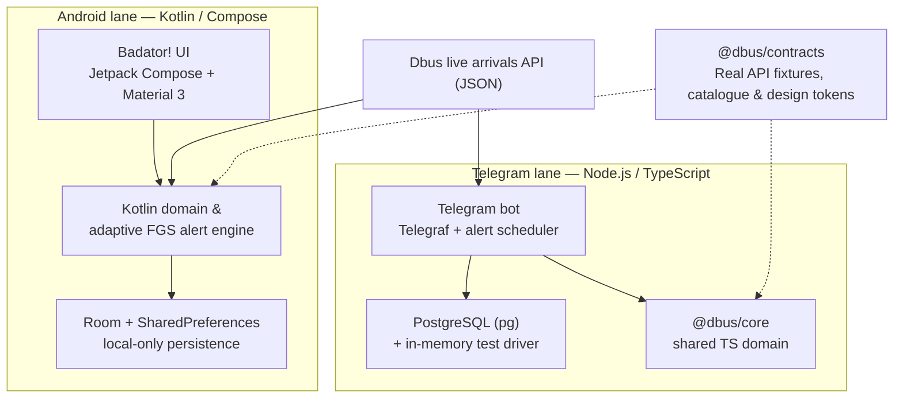

<div align="center">

# Bus Donostia — Badator! (Android) + Telegram Bot

### Know when your bus is coming. Get an alert instead of checking again.

**Live GPS arrivals · Offline stop discovery · One-shot arrival alerts**  
**Native Android application (`Badator!`) + Telegram bot** for Donostia / San Sebastián.

[](https://github.com/IkerGoni/bus-dbus/releases/latest)
[](https://github.com/IkerGoni/bus-dbus/actions/workflows/ci.yml)
[](https://github.com/IkerGoni/bus-dbus/actions/workflows/android.yml)


<sub>Independent open-source project by <strong>Iker Goñi Cuesta (Dev Igoni)</strong>. Not affiliated with Dbus.</sub>

</div>

---

## The problem

I kept reopening and refreshing a transit app just to answer one question: **when should I leave for the bus?**

I wanted something simpler: check live arrival times fast, keep my habitual stops one tap away, and **get a notification when it is time to head out**. That everyday friction became a real-world engineering project: build a reliable, maintainable multi-client product quickly against live transit data using a **parallel, AI-assisted engineering workflow**.

The result is **Bus Donostia**: an operational Telegram bot (`@dbus/bot`) and a native Kotlin/Jetpack Compose Android application (**Badator!**) packaged and verified for Google Play release.

---

## What is inside

| | Telegram bot (`apps/bot`) | Native Android app — **Badator!** (`apps/android`) |
|---|---|---|
| **Purpose** | Check live arrivals and schedule alerts directly from Telegram | Fast everyday access with local adaptive notifications |
| **Features** | Live arrivals, search, lines, favorites, nearby stops (OSM), alert scheduler | Home, nearby/search stops, lines, favorites, one-shot alerts, ES / EU / EN localization |
| **Stack** | Node 22+, TypeScript, Telegraf, PostgreSQL (`pg`) + in-memory test driver, Zod, Vitest, Biome | Kotlin, Jetpack Compose, Material 3, Room, OkHttp, kotlinx.serialization, `minSdk 26`, `targetSdk 36` |
| **Verification** | 93 automated tests + Biome + `tsc -b` (plus 50 shared tests in `packages/`) | 156 JVM/Robolectric tests (debug) / 150 (release) + Android Lint + signed release AAB |
| **Status** | Production-ready (real Dbus API, single-instance lock, 409 retry) | **MVP Base (`v1.1.0`)** — signed APK in [GitHub Releases](https://github.com/IkerGoni/bus-dbus/releases/latest); Google Play rollout in progress |

Both clients consume live data from the Dbus JSON API. The bundled stop catalogue (`548` stops, `39` lines, `127` itineraries) powers instant offline discovery; **it never invents arrival times**.

### Download Badator! — MVP Base (`v1.1.0`)

The current milestone is **MVP Base (`v1.1.0`)**, available as a signed Android APK (`minSdk 26`, Android 8.0+) while the Google Play rollout is completed:

- **Download APK & checksums:** [GitHub Releases — `v1.1.0 — MVP Base`](https://github.com/IkerGoni/bus-dbus/releases/latest)
- **Upgrade note:** the GitHub Release APK is signed with the project release key. When switching later to Google Play (Play App Signing), uninstall the GitHub APK first.

### Badator! (Android) screenshots

| Nearby stops (offline OSM) | Live stop arrivals | One-shot alert setup | Active alerts |
|:---:|:---:|:---:|:---:|
|  |  |  |  |

---

## Built fast. Improved deliberately.

The Git history is part of the engineering story. In the published Git tree, the repository went from its root commit (`2eabe0f`) to the merge of Android Sprint 4 (`0fbdd74`) — including the on-device alert engine — in **12 hours and 42 minutes of elapsed wall-clock time** (the workspace itself was started earlier, on Nov 21 at 18:32 UTC according to session notes; that pre-history is not part of Git), followed by targeted architecture audits, localization, token governance and release hardening.

| Elapsed from root commit (`2eabe0f`) | Recorded milestone |
|---|---|
| **0h 00m** | Root repository commit (`2eabe0f`) · **Nov 22, 2026, 03:56 UTC** |
| **0h 52m** | Live Dbus JSON API integration in Telegram bot (`b724cd1`) · **04:49 UTC** |
| **2h 19m** | Monorepo split with `@dbus/core` and `@dbus/contracts` (`643540b`) · **06:16 UTC** |
| **7h 59m** | First Android Jetpack Compose foundation (`20479eb`) · **11:56 UTC** |
| **9h 50m** | Stops, stop detail and lines screens (`281e6c0`) · **13:46 UTC** |
| **10h 34m** | Home, alerts, settings and onboarding (`45e8fb0`) · **14:31 UTC** |
| **11h 34m** | Android foreground service alert and notification engine (`172aee5`) · **15:31 UTC** |
| **12h 42m** | Sprint 4 integrated into `main` (`0fbdd74`) · **16:39 UTC** |
| **Afterwards** | Architecture audits, adaptive polling, ES/EU/EN parity, compiled `DesignTokens`, PostgreSQL migration, Play Store release pipeline |

Elapsed times and UTC times come from Git commit dates and are truncated to the minute.

> **What this measures:** wall-clock time directly verifiable via `git log` between recorded commits — not net human working hours or a shortcut around testing. The speed comes from **parallel multi-agent orchestration under strict engineering guardrails**.



---

## Parallel multi-agent orchestration, with a developer in control

High output only matters if the codebase stays coherent, tested and releasable. I built this project by **running multiple AI agents in parallel** while keeping **architecture, scope, integration and verification strictly under human control**:

- **Parallel workstreams without collisions:** while one agent implements a feature or refactor inside an isolated **Git worktree** and its assigned **lane** (`apps/android/**` or `apps/bot/**`), I work in parallel with another agent on architecture decisions (ADRs), diagrams, UX refinements, contract parity or security/release audits.
- **Explicit engineering guardrails:** every agent operates under [`AGENTS.md`](AGENTS.md) (non-negotiable product rules, lane ownership, zero-hardcoded-tokens policy, zero opaque internal IDs in UI) and [`docs/contributing/`](docs/contributing/README.md) (Conventional Commits, branch/worktree isolation and mandatory human approval before destructive or remote Git operations).
- **Automated truth over trust:** cross-language domain rules are locked by shared real-API fixtures in `packages/contracts/` and parity tests across TypeScript and Kotlin, backed by **299 automated tests** (`143` TypeScript + `156` Android JVM/Robolectric), Biome, Android Lint, GitHub Actions CI and automated Play Store verification scripts (`tools/play-store/`).



---

## Architecture at a glance

One monorepo, two native client experiences, **zero custom backend** for Android.



The TypeScript bot consumes `@dbus/core` and `@dbus/contracts`. Android maintains a pure, KMP-ready Kotlin domain layer (`domain/` has zero Android or `java.time.*` dependencies) verified against the same real-API contract fixtures.

### Repository map

```text
apps/
  android/             Badator! — native Kotlin + Jetpack Compose app (Gradle)
  bot/                 @dbus/bot — Telegram bot (Node 22+, TypeScript, PostgreSQL)
  mobile/              @dbus/mobile — earlier PWA, frozen by ADR 009
packages/
  core/                @dbus/core — shared TypeScript domain logic
  contracts/           @dbus/contracts — real API fixtures, schemas & design tokens
tools/
  play-store/          Automated privacy, Data Safety, EU review & release checklist scripts
docs/
  03-architecture/     ADRs (including ADR 009: native Android pivot)
  contributing/        Commit conventions, worktree workflow & Git security rules
  privacy/             Published ES / EU / EN privacy policies (GitHub Pages)
  readme/              Screenshots used in this README
.github/workflows/     ci.yml (Node workspaces) and android.yml (Gradle)
AGENTS.md              Engineering guardrails and lane ownership for agents
```

---

## Key engineering decisions

- **One-shot alerts over complex schedules:** the core job is removing repeated manual checks. Pick stop, line and lead time → adaptive Foreground Service monitors (`30s` / `60s` / `120s`) → notifies once → clears automatically (7-day expiration, GPS preference over schedule).
- **Real API behavior over idealized specs:** public GTFS-RT `.pb` feeds returned `403 AccessDenied`, so both clients integrate defensively with Dbus's live JSON endpoint, handling stale data, source type (`tipo=1` GPS vs scheduled), and public vs internal line IDs (e.g., public line `28` vs internal ID `32`).
- **Native Android over PWA ([ADR 009](docs/03-architecture/adrs/009-android-nativo-mvp.md)):** a browser prototype was built first and deliberately frozen in favor of Kotlin + Compose for reliable local persistence, background alert lifecycle and Android-native UX — without operating a paid backend or Firebase.
- **Privacy by design:** zero analytics, zero ads, zero trackers, `android:allowBackup="false"`, and ephemeral in-memory location used only on demand to sort nearby stops offline.
- **Design & config discipline:** 3-tier configuration model (`assets/config.json` for runtime operational parameters, compile-time generated `DesignTokens`/`MotionTokens` guarded by `DesignTokensGuardTest`, and strict reduced-motion accessibility).

---

## Verification and getting started

### Requirements

- **Node.js 22+** and **pnpm** (bot and shared packages)
- **JDK 17** and **Android SDK** (Android app; see [`apps/android/README.md`](apps/android/README.md))
- A **separate Telegram `BOT_TOKEN`** via environment variable if running your own bot instance (never commit tokens or reuse production credentials)

### Verify TypeScript workspaces (lint + typecheck + 143 tests + build)

```bash
pnpm install --frozen-lockfile
pnpm verify
pnpm run build:ci
```

### Verify and build Android (lint + 156 debug / 150 release JVM tests + APK)

```bash
cd apps/android
./gradlew check assembleDebug
```

### Run the Telegram bot locally

```bash
cd apps/bot
export BOT_TOKEN='your_dev_bot_token'
pnpm run build && npm run start
```

> **Operational note:** never launch a second polling instance against the same `BOT_TOKEN` (triggers Telegram `409` conflicts). `git push` does not deploy or restart the production bot.

---

## Feedback & Roadmap

We are currently in **MVP Base (`v1.1.0`)** and actively gathering real-world feedback from everyday commutes in Donostia to prioritize what ships next.

### Share feedback (ES / EU / EN welcome)

- **Found a bug or weird arrival/alert behavior?** [Open a bug report](https://github.com/IkerGoni/bus-dbus/issues/new?template=bug_report.yml)
- **Have UX feedback or an improvement idea?** [Share feedback / suggest a feature](https://github.com/IkerGoni/bus-dbus/issues/new?template=feedback.yml)
- **Prefer email?** `dev.mail.igoni@gmail.com`

### Roadmap

- **Now — `v1.1.0` (MVP Base)**
  - Live GPS arrivals, offline stop discovery (`548` stops, `39` lines, `127` itineraries), nearby stops (offline OSM), favorites, one-shot adaptive alerts, ES / EU / EN localization, and the `@dbus/bot` Telegram bot.
- **Soon**
  - **Google Play Store launch** (closed testing and public rollout).
  - **Feedback-driven refinements** prioritized from real-world MVP Base usage.
  - **UX & interaction polish (`v1.2`)** — swipe-to-dismiss alerts with undo, animated alert setup wizard, lightweight native Canvas mascot for empty/onboarding states, and native Euskara review.
- **Later / Exploring**
  - **Native iOS app (`v2.0`)** — Kotlin Multiplatform (KMP) shared domain + native SwiftUI UI.
  - **Optional static remote config** (`REMOTE_CONFIG_URL`) to tune operational polling parameters without requiring an app update.

---

## Status, limitations and external dependencies

- **External data source:** both products rely on Dbus's public, unofficial JSON endpoint (`app.dbus.eus`, currently HTTP-only for that host via scoped `network_security_config.xml`). Availability and schema are controlled by the transit operator.
- **Android notifications:** alert timing on Android is subject to OS battery optimization, notification permissions and network connectivity.
- **Frozen PWA (`apps/mobile`):** kept in the repository for architectural traceability (ADR 009); excluded from CI and not maintained.

---

## Privacy, Google Play and Licensing

- **Developer / Support:** **Iker Goñi Cuesta (Dev Igoni)** · `dev.mail.igoni@gmail.com`
- **Privacy policies (Badator!):**
  - [Español](https://ikergoni.github.io/bus-dbus/privacy/privacy-policy-es.html)
  - [Euskara](https://ikergoni.github.io/bus-dbus/privacy/privacy-policy-eu.html)
  - [English](https://ikergoni.github.io/bus-dbus/privacy/privacy-policy-en.html)
- **License:** original source code in this repository is licensed under the [MIT License](LICENSE). Bundled typography in `apps/android/licenses/` remains under SIL Open Font License 1.1. Stop coordinates use OpenStreetMap data (`© OpenStreetMap contributors, ODbL`). Dbus trademarks and live transit data belong to their respective owners.
- **Further documentation:** [`AGENTS.md`](AGENTS.md) · [`docs/README.md`](docs/README.md) · [`docs/contributing/`](docs/contributing/README.md)
